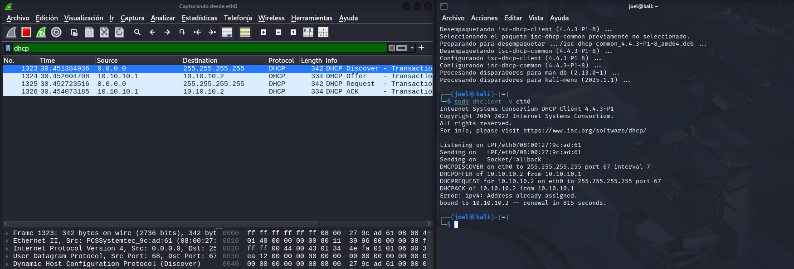
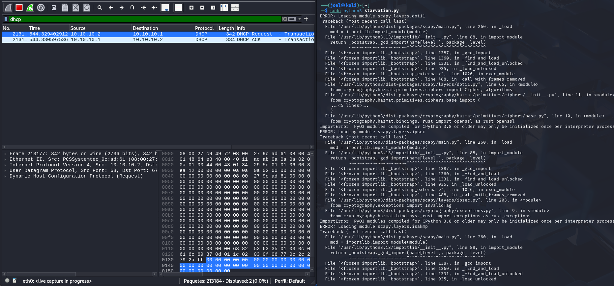
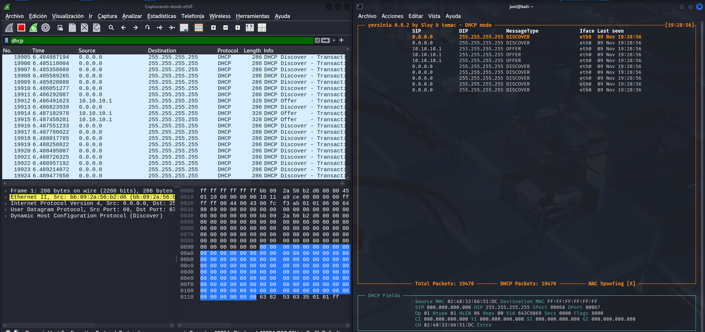
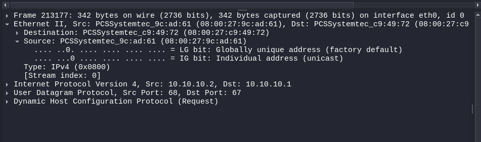
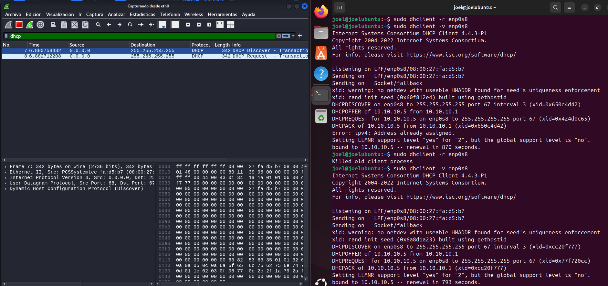
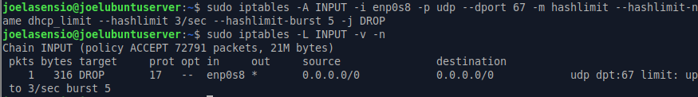
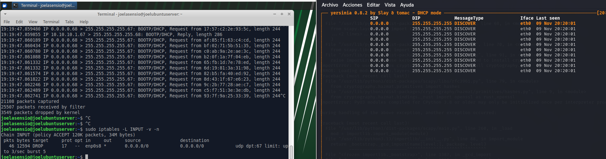

## 1. Objetivo

Comprender el impacto del agotamiento del direccionamiento IP dinámico (DHCP
Starvation) en una LAN, analizar el tráfico malicioso y aplicar mitigaciones a
nivel de host Linux. En concreto:

- Entender el intercambio DHCP **DORA** (DISCOVER, OFFER, REQUEST, ACK).
- Demostrar cómo un atacante agota el *pool* IPv4 simulando cientos de clientes falsos.
- Analizar con Wireshark el patrón de ataque (MAC Ethernet de Capa 2 vs. campo `chaddr` de Capa 7).
- Implementar y validar contramedidas: *rate limiting* con iptables y endurecimiento del servidor.

## 2. Topología del laboratorio

| VM | Rol | Adaptadores de red |
|----|-----|--------------------|
| **VM1 Kali** | Atacante | Red Interna (Modo promiscuo: *Permitir todo*) |
| **VM2 Ubuntu Server** | Servidor DHCP (Kea) | Ad.1 NAT + Ad.2 Red Interna (promiscuo) |
| **VM3 Ubuntu/Debian** | Cliente legítimo | Red Interna (promiscuo) |

Las tres VMs comparten la misma *Red Interna* de VirtualBox con **Modo
Promiscuo → Permitir todo**, requisito imprescindible para que las tramas con
MAC de origen falsificada circulen por la red virtual.

---

## 3. Línea base — funcionamiento normal

### 3.1 Comprobación del servidor Kea (VM2)

```bash
sudo systemctl status kea-dhcp4-server
sudo kea-dhcp4 -t /etc/kea/kea-dhcp4.conf     # valida la sintaxis del JSON
```

### 3.2 Primera solicitud DORA desde el cliente (VM3)

```bash
sudo apt update && sudo apt install -y isc-dhcp-client
sudo dhclient -v enp0s3
ip a
```

El cliente completa el intercambio **DISCOVER → OFFER → REQUEST → ACK** y
recibe una IP del rango configurado en el servidor.



### 3.3 Concesión registrada en el servidor (VM2)

En Kea las concesiones se guardan en un CSV, no en `dhcpd.leases`:

```bash
sudo cat /var/lib/kea/kea-leases4.csv
```

Se observa la pareja **MAC ↔ IP** asignada al cliente legítimo (estado del
sistema *antes* del ataque).

---

## 4. Ejecución del ataque — DHCP Starvation (VM1 Kali)

### 4.1 Método A — Script en Python (Scapy)

El script falsifica simultáneamente la **MAC de la trama Ethernet** y el campo
**`chaddr`** del *payload* DHCP, generando una transacción distinta por cada
paquete para que el servidor las interprete como clientes diferentes.

```bash
sudo python3 starvation.py     # Ctrl+C para detener
```



### 4.2 Método B — Yersinia

```bash
sudo yersinia -G     # DHCP → sending DISCOVER packets → ~15 s → stop
```



### 4.3 Análisis en Wireshark

Filtro de visualización: `dhcp`. Al inspeccionar una trama del ataque se
comprueba que la dirección de **Ethernet → Source (L2)** coincide con **DHCP →
Client hardware address / `chaddr` (L7)**: el script altera ambos campos a la
vez con la misma MAC aleatoria.



---

## 5. Validación del impacto (Denegación de Servicio)

### 5.1 Agotamiento del pool (VM2)

```bash
sudo tail -n +2 /var/lib/kea/kea-leases4.csv | awk -F, '{print $1}' | sort -u | wc -l
```

En pocos segundos el número de IPs asignadas llena todo el pool: no quedan
direcciones disponibles para nuevos nodos.

### 5.2 El cliente legítimo deja de obtener IP (VM3)

```bash
sudo dhclient -r enp0s3     # libera la concesión actual
sudo dhclient -v enp0s3     # solicita de nuevo
```

El cliente queda en un **bucle infinito de DHCPDISCOVER sin recibir OFFER**: la
red está indisponible. Esta es la evidencia de la DoS.



---

## 6. Mitigación — Rate limiting con iptables (VM2)

### 6.1 Adaptación de la regla a nf_tables

El enunciado propone limitar por MAC de origen con `--hashlimit-mode srcmac`.
Sin embargo, en el sistema de pruebas (**iptables v1.8.10, backend
`nf_tables`**) ese modo **no está soportado** — solo admite `srcip`, `dstip`,
`srcport`, `dstport` — y además carece de sentido en este ataque, ya que todos
los DISCOVER falsos usan IP de origen `0.0.0.0`. Por ello se aplica un
**límite global** sobre las peticiones DHCP de entrada al puerto 67:

```bash
sudo iptables -F INPUT
sudo iptables -A INPUT -i enp0s8 -p udp --dport 67 \
  -m hashlimit --hashlimit-name dhcp_limit \
  --hashlimit-above 3/sec --hashlimit-burst 5 -j DROP
sudo iptables -L INPUT -v -n
```

> **Nota de interfaz:** `enp0s8` es el adaptador conectado a la *Red Interna*.
> Antes de aplicar la regla conviene confirmar por dónde entra el tráfico con
> `sudo tcpdump -n udp port 67`.



---

## 7. Prueba de la defensa

### 7.1 Reset del pool y relanzamiento del ataque

```bash
# Liberar el pool de Kea
sudo systemctl stop kea-dhcp4-server
sudo rm -f /var/lib/kea/kea-leases4.csv*
sudo systemctl start kea-dhcp4-server
```

Con el ataque de nuevo en marcha desde Kali, se observa el contador de la regla
en el servidor:

```bash
sudo iptables -L INPUT -v -n
```

El contador de **pkts** de la regla `DROP` se incrementa rápidamente: el
bombardeo queda neutralizado en primera línea de defensa.



### 7.2 El cliente legítimo recupera la conectividad (VM3)

```bash
sudo dhclient -v enp0s3
```

El cliente obtiene su direccionamiento con normalidad, demostrando que la
operatividad legítima de la red no se ve afectada por la mitigación.

---

## 8. Otras mitigaciones (nivel de infraestructura)

### 8.1 DHCP Snooping (switch de acceso, Cisco IOS)

```cisco
ip dhcp snooping
ip dhcp snooping vlan 10
interface gi0/1                 ! puerto hacia el servidor DHCP legítimo
 ip dhcp snooping trust
interface range gi0/2-24        ! puertos de usuarios = untrusted
 ip dhcp snooping limit rate 10
```

El switch marca como *trusted* únicamente el puerto del servidor legítimo; por
los puertos *untrusted* solo deja pasar mensajes de cliente (DISCOVER/REQUEST)
y limita su tasa, cortando la inundación.

### 8.2 Port Security

```cisco
interface range gi0/2-24
 switchport port-security
 switchport port-security maximum 2
 switchport port-security violation restrict
 switchport port-security mac-address sticky
```

### 8.3 Endurecimiento del servidor Kea

El `deny unknown-clients;` es sintaxis de ISC DHCP y **no existe en Kea**. El
equivalente es la clasificación de clientes `KNOWN`/`UNKNOWN` con reservas: solo
los clientes con reserva obtienen IP del pool.

```json
"subnet4": [{
  "subnet": "10.0.0.0/24",
  "pools": [{ "pool": "10.0.0.100 - 10.0.0.150", "client-class": "KNOWN" }],
  "reservations": [
    { "hw-address": "08:00:27:xx:xx:xx", "ip-address": "10.0.0.100" }
  ]
}]
```

---

## 9. Preguntas

### 9.1 Análisis de capas — ¿por qué alterar a la vez la MAC Ethernet (L2) y el `chaddr` (L7)?

El servidor DHCP **no identifica al cliente por la MAC de la trama Ethernet,
sino por el campo `chaddr`** (client hardware address) del *payload* y, en su
caso, por el `client-id`. De ahí que haya que falsificar **ambos** campos:

- **Si solo cambia el `chaddr` (L7)** y la MAC Ethernet se mantiene fija: el
  servidor sí entrega una concesión distinta por cada `chaddr` (se agotaría el
  pool), pero todas las tramas salen de **una única MAC de Capa 2**. Eso lo
  detectan y bloquean trivialmente las defensas de L2: *Port Security* con
  `maximum 1-2` corta el ataque de inmediato, y DHCP Snooping con verificación
  de MAC descarta las tramas porque `chaddr` ≠ MAC de origen.
- **Si solo cambia la MAC Ethernet (L2)** y el `chaddr` se mantiene fijo: el
  servidor ve siempre **el mismo cliente** (mismo `chaddr`), por lo que
  renueva/reutiliza la misma concesión en lugar de asignar nuevas. El pool
  **no se agota** y el ataque fracasa.

Por tanto, el atacante necesita variar el `chaddr` para drenar el pool (cada
paquete parece un cliente nuevo) **y** variar la MAC Ethernet de forma
coherente con él (MAC = `chaddr`, como haría un cliente real) para evadir los
controles de Capa 2. Modificar uno solo de los dos campos, o bien no agota el
pool, o bien es fácilmente mitigable.

**Matiz importante (lo que pide "investigar"):** ebtables compara un campo
contra un valor estático, pero **no puede comparar de forma nativa dos campos
del mismo paquete entre sí** (la MAC de origen Ethernet frente a los bytes del
`chaddr`, que viven dentro del *payload* DHCP). Es decir, no existe un *match*
tipo "`chaddr` == src MAC" en ebtables.

```bash
sudo nft add table bridge filter
sudo nft add chain bridge filter input '{ type filter hook input priority 0; }'
sudo nft add rule bridge filter input udp dport 67 \
  meter dhcpflood '{ ether saddr limit rate over 3/second }' drop
```

---

## 10. Conclusiones

El ataque de DHCP Starvation demuestra cómo, con herramientas estándar y en una
red sin protección, un único nodo puede dejar sin servicio a toda una LAN
agotando el pool de direcciones. La defensa eficaz es **en profundidad**:
limitación de tasa en el host (iptables/nftables), controles de Capa 2 en el
switch (DHCP Snooping y Port Security) y endurecimiento del propio servidor
(clasificación de clientes en Kea). La mitigación aplicada frena la inundación
sin degradar el servicio a los clientes legítimos.
